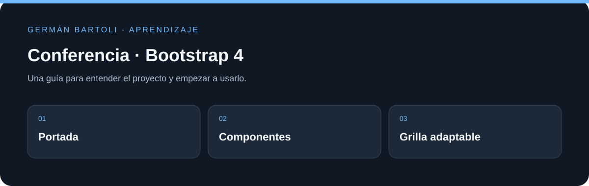

# Conferencia · Bootstrap 4

**Página de práctica de Bootstrap 4 con navegación, presentación de una conferencia y ejercicios de grilla.**

[Empezar](#primeros-pasos) · [Mapa del repositorio](#mapa-del-repositorio) · [Autoría](#autoría-de-esta-documentación)

*Esquema de orientación; no representa una captura de la aplicación.*

## Primeros pasos

1. Abrí `index.html` o el sitio publicado indicado debajo.
2. Probá la navegación y cambiá el ancho de la ventana para revisar la grilla.
3. Compará el proyecto con `Reto - La grilla de Bootstrap.html` para estudiar las columnas y los puntos de quiebre.

## Entorno de aprendizaje

Este repositorio conserva ejercicios y versiones de su etapa de estudio. Revisá los archivos de proyecto para preparar el SDK, runtime o servidor correspondiente; esta actualización del README no migra dependencias ni acredita una ejecución reciente de todos los ejemplos.

## Enlaces

- [Sitio publicado en GitHub Pages](https://germanbartoli.github.io/Bootstrap4-Course-Platzi/)
- [Repositorio en GitHub](https://github.com/GermanBartoli/Bootstrap4-Course-Platzi)

## Mapa del repositorio

- [index.html](<index.html>)
- [docs/PUBLICACION.md](<docs/PUBLICACION.md>)

## Autoría de esta documentación

Repositorio mantenido por [Germán Bartoli](https://github.com/GermanBartoli). Guía revisada y actualizada con **Codex**, coautor de esta actualización documental. Los autores, colaboradores, licencias y recursos de terceros conservan sus créditos originales.

Los commits de esta revisión incluyen `Co-authored-by: Codex <noreply@openai.com>`; esta atribución no modifica la autoría del historial anterior.
